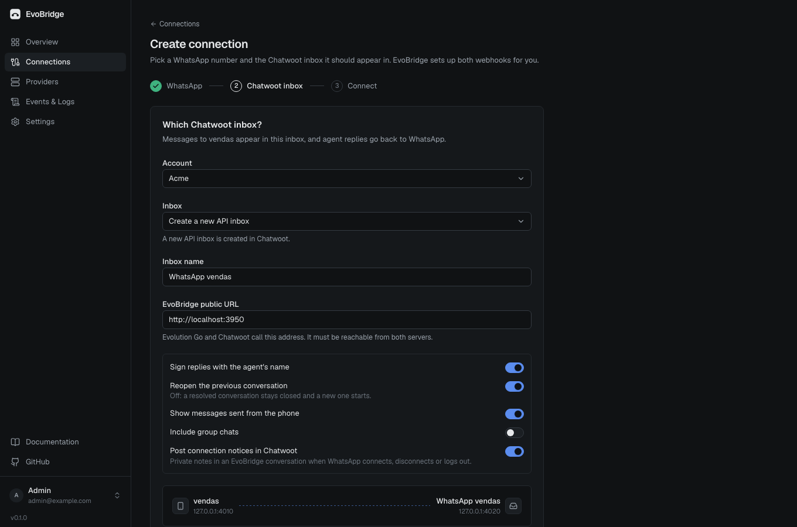
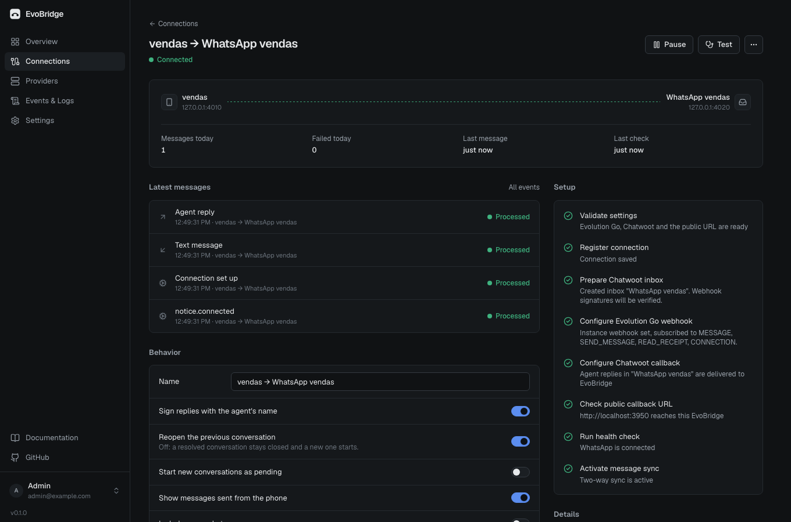
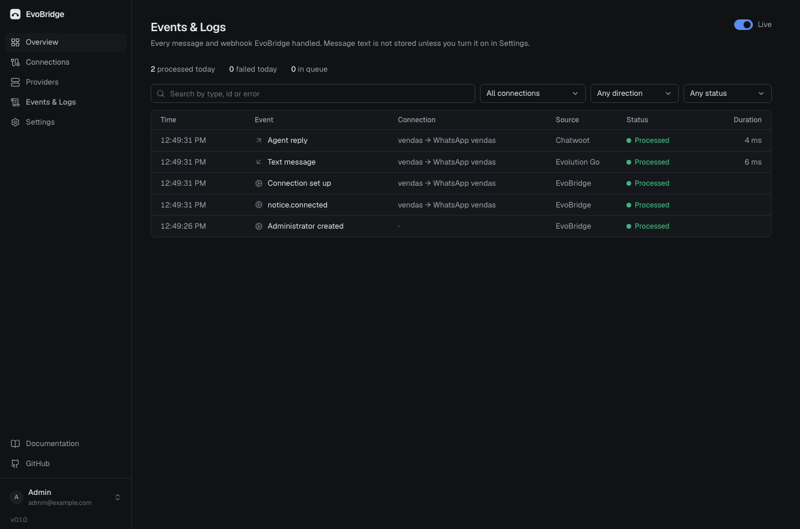

# EvoBridge

The simplest open-source bridge between [Evolution Go](https://github.com/evolution-foundation/evolution-go) and [Chatwoot](https://www.chatwoot.com).

You connect a WhatsApp number running on Evolution Go to a Chatwoot inbox from a web dashboard. You don't need n8n, a paid bridge, or to copy webhook URLs by hand.


## What it does

- **Setup.** You enter your Evolution Go and Chatwoot credentials once. EvoBridge lists your WhatsApp instances and Chatwoot inboxes. It can create a new instance and pair it by QR code or pairing code, and it can create a new API inbox.
- **Webhooks.** It configures both webhooks for you and checks each step before marking it done. If a webhook already points to another service, EvoBridge asks first, then forwards every event to that service so it keeps working.
- **Messages in both directions.** Customer messages show up in Chatwoot. Agent replies are sent to WhatsApp, with the agent's name, quoted replies, attachments and deletes. Messages typed on the phone also appear in Chatwoot.
- **Reliable delivery.**
  - Every event goes through a durable queue, with retries, exponential backoff and a dead-letter list you can replay.
  - Messages are never duplicated or looped, even when providers retry or deliver out of order.
  - Messages from one chat are processed in order.
- **Connection notices.** EvoBridge posts private notes in Chatwoot when WhatsApp connects, disconnects or logs out.
- **Observability.** You get connection health from real checks, plus an events and logs page. Message content is not logged by default.
- **Self-hosted.** It is one container with SQLite inside. Credentials are encrypted at rest.

| Create a connection | Connection | Events & Logs |
|---|---|---|
|  |  |  |

## Install

```bash
curl -fsSLO https://raw.githubusercontent.com/evobridge/evobridge/main/docker-compose.yml
docker compose up -d
```

Open `http://<server>:3000`, create the administrator and follow the onboarding.

There are step-by-step guides for **EasyPanel, Dokploy, Coolify** and **HTTPS with Caddy** in [docs/INSTALL.md](docs/INSTALL.md).

**Requirements**

- **Evolution Go**, activated, with its global API key.
- **Chatwoot 4.x**, with an administrator access token.
- **A public address** for EvoBridge, so both can send webhooks to it.

## How it works

One Node.js process serves the dashboard and the API, receives webhooks, and runs the worker. SQLite holds everything.

Webhooks are verified, de-duplicated and queued, then answered right away. Chatwoot gives up after 5 seconds and never retries.

The worker turns each event into the matching API call on the other side. It keeps a map of WhatsApp ↔ Chatwoot ids, which it uses for replies, deletes, read receipts and echo suppression.

The design and every decision are in [docs/ARCHITECTURE.md](docs/ARCHITECTURE.md). The provider APIs were audited from their source code; the reports are in [docs/research](docs/research).

## Known limitations

- **Hidden phone numbers.** WhatsApp sometimes hides the customer's number behind a LID. EvoBridge then names the contact from the WhatsApp profile and adds the number as soon as WhatsApp reveals it.
- **Audio in Chatwoot 4.x.** Audio may show `00:00` until the page is reloaded. This is a Chatwoot bug ([#14644](https://github.com/chatwoot/chatwoot/issues/14644)).
- **Edits from Chatwoot.** Chatwoot can't edit sent messages. Edits made on WhatsApp appear as a reply marked as edited.

## Development

```bash
pnpm install
pnpm --filter @evobridge/server demo:providers   # fake Evolution Go (:4010) and Chatwoot (:4020)
ALLOW_PRIVATE_NETWORKS=true pnpm --filter @evobridge/server dev   # API on :3000
pnpm --filter @evobridge/web dev                 # dashboard on :3001
```

```bash
pnpm test            # server tests against realistic fake providers
pnpm build && pnpm test:e2e   # Playwright: full flow in a browser
```

See [CONTRIBUTING.md](CONTRIBUTING.md).

## Trademarks

EvoBridge is an independent project. It is not affiliated with, endorsed by or sponsored by Evolution Foundation or Chatwoot.

- "Evolution Go" is a trademark of Evolution Foundation, and "Chatwoot" is a trademark of Chatwoot Inc. Both names are used only to describe compatibility.
- Evolution Go's license asks projects that use it to say so. If you use EvoBridge, your installation uses Evolution Go.

## License

[MIT](LICENSE)
